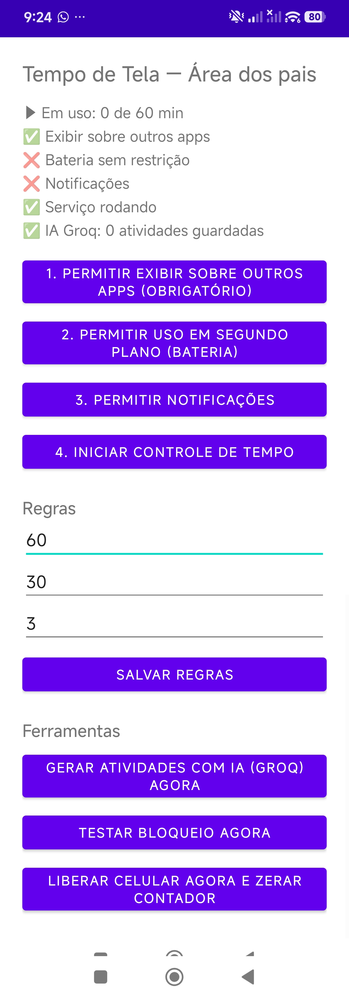

# KidScreenTime — Tempo de Tela com Atividades Educativas

App Android de **controle parental** que troca o "bloqueio puro" por aprendizado. Depois de um tempo de uso, o celular bloqueia, e a criança só libera respondendo atividades de alfabetização e matemática. O nível das atividades se ajusta ao desempenho dela.

**Stack:** Kotlin · Android SDK (Views) · Foreground Service · `SYSTEM_ALERT_WINDOW` · LLM via API do Groq · JUnit · Gradle KTS

### Destaques técnicos
- **Bloqueio por janela sobreposta** (`LockOverlay.kt`): o bloqueio fica por cima de qualquer app. Antes ele usava uma Activity, que o Android 10+ impede de abrir em segundo plano.
- **Serviço em primeiro plano** (`TimeTrackerService.kt`): conta só o tempo com a tela ligada e destravada, e volta a funcionar depois de reiniciar o aparelho (`BootReceiver`).
- **PIN dos pais com PBKDF2** e limite de tentativas: o PIN nunca fica salvo em texto puro.
- **Perguntas geradas por código** (`LocalQuestions.kt`, `WordBank.kt`): o gabarito é calculado, então nunca vem errado.
- **IA com verificação** (`GroqClient.kt`): cada pergunta gerada pela IA passa por uma segunda chamada "às cegas", com temperatura 0, e só fica se as respostas baterem. Sem internet, o app usa as perguntas locais.
- **Correção tolerante** (`AnswerMatcher.kt`): ignora acentos, maiúsculas e artigos, e aceita números por extenso. Tem **testes unitários** (`AnswerMatcherTest`, `LocalQuestionsTest`).
- **Nível adaptativo e detecção de chute** (`Progress.kt`, `GuessDetector.kt`): o nível sobe com 80% ou mais de acerto e desce abaixo de 50%. Os pais veem um relatório por habilidade.
- **Atualização automática** (`UpdateChecker.kt`): o app busca a versão mais nova no GitHub Releases, valida o pacote e o número da versão, e abre o instalador.
- **Segredos fora do código:** a chave da API e o certificado de assinatura ficam no `local.properties`, que está no `.gitignore`.

 

---

# Tempo de Tela — Controle Parental (v0.2)

Ciclo: **60 min de tela → bloqueio de 30 min → só libera com atividade feita E pausa terminada.**
A pausa conta a partir do momento do bloqueio. Tudo configurável na tela dos pais.

## Atividades (perguntas)
- **Geradas no próprio app** (`LocalQuestions.kt` + `WordBank.kt`): letra inicial/final/que falta, sílabas,
  juntar sílabas, contar letras/vogais, escrever palavra, alfabeto, contagem, soma, subtração, sequência,
  maior/menor. O gabarito é calculado pelo código — nunca vem errado.
- **IA do Groq** só para conhecimentos gerais (animais, natureza, corpo…). Cada pergunta passa por uma
  conferência às cegas (2ª chamada, temperatura 0); só fica o que bate. Erro em pergunta da IA não dá castigo.
- **Comparação tolerante** (`AnswerMatcher.kt`): ignora acento, maiúscula, pontuação, hífen, artigo
  ("o gato"), aceita número por extenso ("quatro" = 4) e plural simples. Ortografia continua contando.
- **Errou?** Aparece a resposta certa com explicação, a criança digita a resposta certa para seguir, e a pergunta
  volta para revisão 2–3 perguntas depois.
- **Nível adaptativo** por habilidade (`Progress.kt`): ≥ 80% de acerto sobe, < 50% desce (níveis 1 a 3).
- **🔊 Ouvir**: lê a pergunta em voz alta (pt-BR).
- **Área dos pais na tela de bloqueio → 🚩 Pergunta errada**: descarta a pergunta e devolve o castigo.
- **Relatório** na tela dos pais: acertos por habilidade, nível, sinais de chute (`GuessDetector.kt`) e últimos erros.

## Atualização automática (GitHub Releases)
Ao abrir a **Área dos pais**, o app procura uma versão nova no repositório `UPDATE_REPO` (no `local.properties`,
ex.: `UPDATE_REPO=seu-usuario/tempo-de-tela`) e mostra **"Atualizar agora"**: baixa o APK e abre o instalador.
- Publicar: rode `.\publicar.ps1` (aumenta a versão e gera `dist\tempo-de-tela-vN.apk`) e crie a release no GitHub
  com a tag **`vN`** (N = VERSION_CODE), o título = versão e o APK anexado. O repositório precisa ser **público**.
- **Chave de assinatura**: `keystore/tempo-de-tela.jks` + senha no `local.properties`. Faça backup dos dois —
  sem eles, nenhuma versão nova instala por cima da antiga.

## O que mudou na v0.2
- Bloqueio agora é uma **janela sobreposta** (`LockOverlay.kt`): fica por cima de qualquer app, mesmo com Home/Recentes.
  (Antes era uma Activity aberta em segundo plano — o Android 10+ bloqueia isso, o bloqueio nunca apareceria.)
- Tempo só conta com tela **ligada e destravada**.
- Atividades de **múltipla escolha** (3 botões, sem teclado), botão 🔊 Ouvir (voz em pt-BR) e vários acertos (padrão 3).
- **IA do Groq** (`GroqClient.kt`): gera perguntas de letras, palavras, animais, cores etc. A fila fica salva no
  aparelho (funciona offline). Sem internet/chave -> continhas locais.
- **PIN dos pais**: protege a tela de configuração e libera o celular na tela de bloqueio ("Área dos pais").
- Limites configuráveis (acabou o "1 minuto de teste" fixo no código) + botões "Testar bloqueio" e "Liberar agora".
- Serviço religa no boot e após atualizar o app.

## Configurar o Groq
1. Crie a chave grátis em https://console.groq.com/keys
2. No `local.properties` (raiz do projeto) adicione: `GROQ_API_KEY=gsk_xxxxxxxx`
3. Gere o APK de novo. (A chave fica embutida no APK — ok para uso pessoal, não publique o APK nem o local.properties.)

## Gerar o APK (Android Studio)
`Build > Build APK(s)` -> `app/build/outputs/apk/debug/app-debug.apk`
ou no PowerShell: `.\gradlew.bat assembleDebug`

## Instalar e configurar no celular do filho (nesta ordem)
1. Instale o APK (permita "instalar apps desconhecidos"; se o Play Protect avisar, escolha "instalar mesmo assim").
2. Abra o app -> crie o **PIN**.
3. Botão 1: permitir **exibir sobre outros apps** (obrigatório).
4. Botão 2: bateria **sem restrição**. Em Xiaomi/Samsung/Motorola também ative "Início automático"/"Sem restrições" nas configurações do app.
5. Botão 3: notificações. Botão 4: iniciar controle.
6. Toque em **Gerar atividades com IA** e depois em **Testar bloqueio agora** para validar.
7. Ajuste as regras (60/30/3) e salve. Teste o ciclo real antes de entregar o celular.

## Limitações (honestas)
- É bloqueio "soft": uma criança de 6 anos não burla, mas alguém que saiba abrir Configurações pode forçar a parada
  do app ou revogar a permissão, ou desinstalar. Para blindar de verdade: Device Owner/Lock Task (ou Google Family Link
  como segunda camada).
- Mudar a data/hora do aparelho pode encurtar a pausa.
- Código novo não foi compilado/testado em aparelho real — rode o checklist do passo 6/7.
